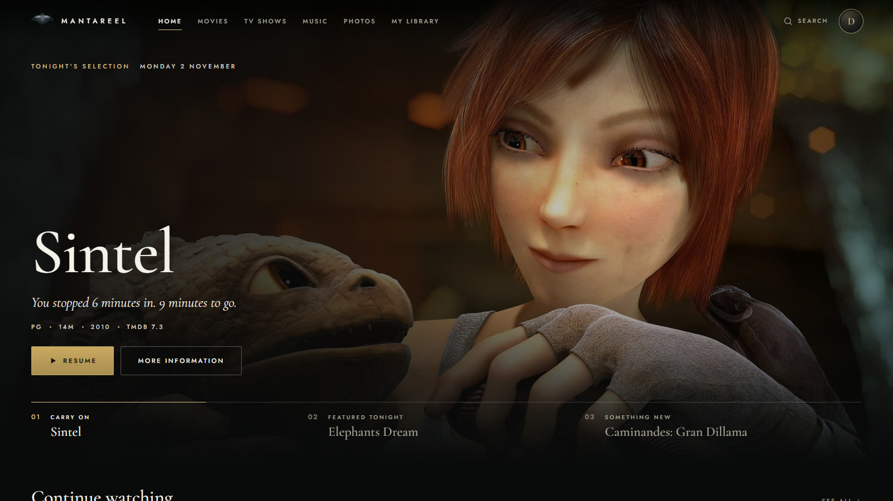
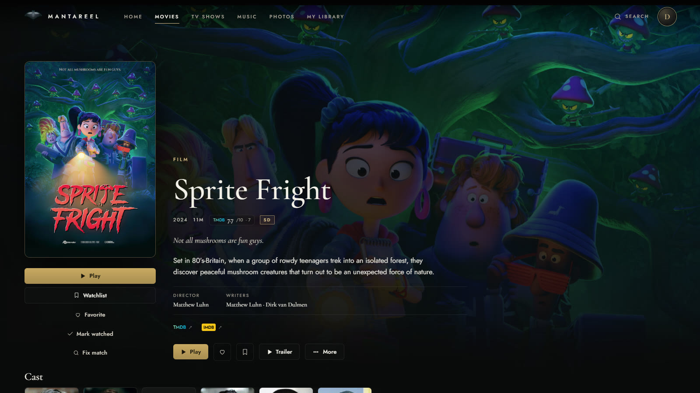
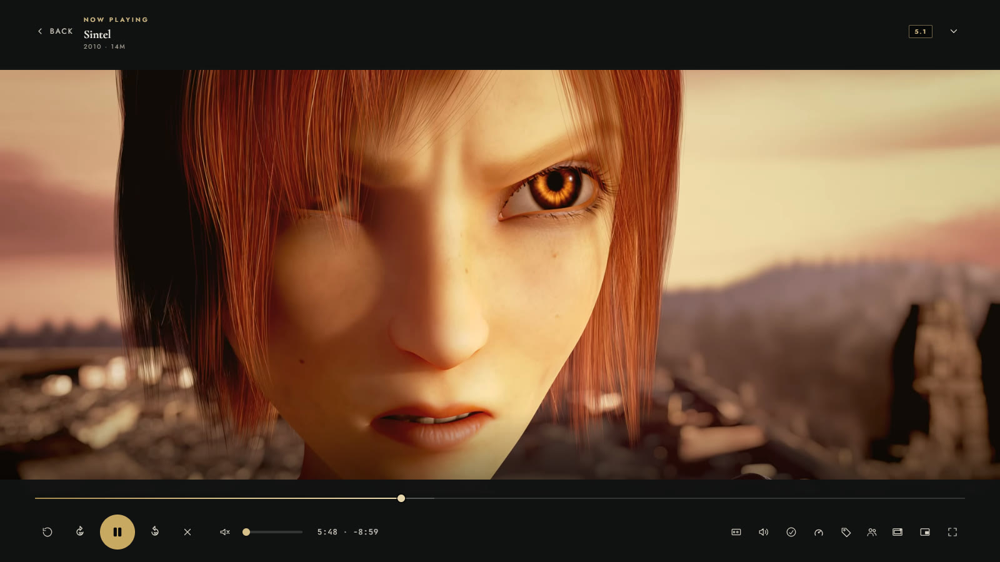
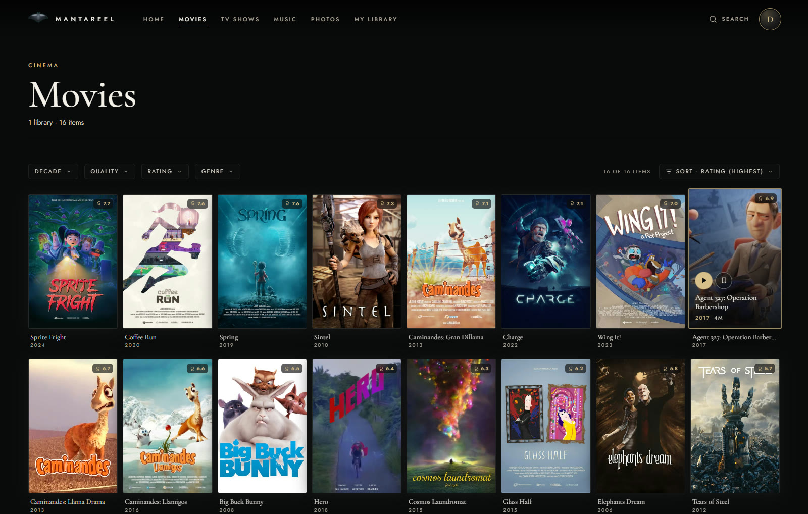
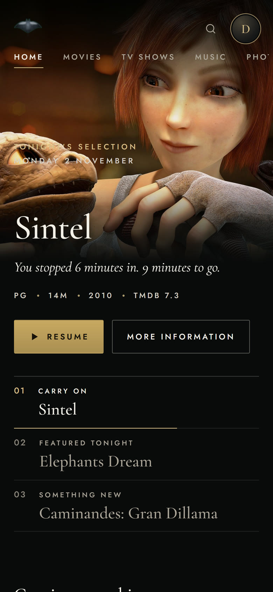
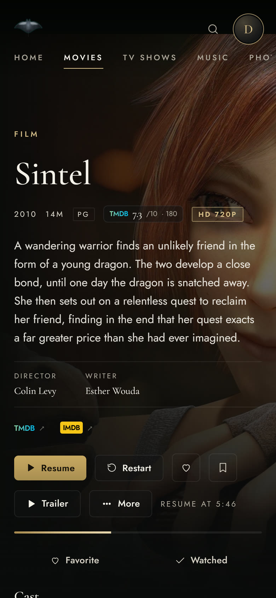

<p align="center">
  
</p>

<h1 align="center">Mantareel</h1>

<p align="center">
  <b>Your films, shows, music and photos — streamed from your own server to every screen you own.</b><br />
  Private by default. No account with us. Works without us.
</p>

<p align="center">
  <a href="../../releases/latest"><b>Download</b></a> ·
  <a href="docs/GUIDE.md"><b>Setup guide</b></a> ·
  <a href="docs/RELEASE-NOTES-1.2.0.md">What's new in 1.2.0</a> ·
  <a href="../../issues">Report a problem</a>
</p>

<p align="center">
  
</p>

---

> **Public beta.** Mantareel 1.2.0 is free while in beta. It runs every day on real
> home servers, but expect rough edges — and please report them.

## What it is

Mantareel is a media server you run at home. Point it at the folders where your
films, TV shows, music and photos already live; it organises them, fetches posters
and summaries, and streams them to your browser, phone and TV — at home or away.

- **Full 4K, HDR and Dolby Vision**, with hardware transcoding on Intel, AMD and
  NVIDIA graphics when a device can't play the original.
- **Every audio language and subtitle** in your files, switchable while you watch.
  English plays first; pick any other in one tap.
- **Profiles for the household** — kids' profiles with age limits, profile PINs,
  per-person libraries and watch history.
- **Up next** for TV shows, intro and credits markers, continue watching, a watchlist.
- **Watch together** — synchronised playback across devices.
- **Remote access without a cloud account** — built-in guides for WireGuard and
  Tailscale, or your own reverse proxy.
- **On-device search and recommendations** — computed on your server, not sent anywhere.

### What it promises

| | |
|---|---|
| **Private by default** | Nothing is public unless you decide to make it public. |
| **No account with us** | You create accounts on *your* server. We never see them. |
| **Works without us** | No sign-in hub, no licence server. If we vanished tomorrow, your server keeps working. |
| **Your media stays yours** | Mantareel never hosts, uploads or relays your media. |

## Screenshots

<table>
  <tr>
    <td width="50%"></td>
    <td width="50%"></td>
  </tr>
  <tr>
    <td align="center"><sub>Every film gets its poster, artwork, cast and ratings</sub></td>
    <td align="center"><sub>The player: audio and subtitle tracks, quality, watch together</sub></td>
  </tr>
  <tr>
    <td colspan="2"></td>
  </tr>
  <tr>
    <td colspan="2" align="center"><sub>Browse by decade, quality, rating and genre</sub></td>
  </tr>
</table>

<p align="center">
  
  &nbsp;
  
</p>
<p align="center"><sub>The same library on your phone</sub></p>

<p align="center"><sub>Screenshots use Blender Studio's open movies (<a href="https://studio.blender.org/films/">studio.blender.org</a>, CC BY) as a demo library.
Artwork © Blender Foundation, from <a href="https://www.themoviedb.org/">TMDB</a>.</sub></p>

## Download

Get everything from the **[latest release](../../releases/latest)**.

| You want to run the server on… | Get |
|---|---|
| **Docker** (Linux, Synology, QNAP, Unraid, TrueNAS, Windows/Mac with Docker Desktop) | `ghcr.io/zombievet/mantareel:1.2.0` — see [Docker](docs/GUIDE.md#2a-docker-recommended) |
| **Ubuntu / Debian** (Intel or AMD) | `mantareel_1.2.0_amd64.deb` |
| **Raspberry Pi 4/5 and other ARM boards** *(experimental)* | `mantareel_1.2.0_arm64.deb` or the Docker image |
| **Windows 10/11** | `mantareel-setup-1.2.0.exe` |

| You want to watch on… | Get |
|---|---|
| **Any browser** | Nothing to install — open your server's address |
| **Android phone or tablet, NVIDIA Shield, Android TV** | `mantareel-android-2.2.0.apk` |
| **Roku** *(beta)* | `mantareel-roku-1.6.zip` — [install in 10 minutes](docs/GUIDE.md#roku-beta) |
| **Samsung TV** 2021+ *(beta)* | `mantareel-samsung-tv-3.7.4.zip` + `install-samsung-tv.ps1` — [one-time setup](docs/GUIDE.md#samsung-tv-beta) |

## Quick start (Docker)

```yaml
# docker-compose.yml
services:
  mantareel:
    image: ghcr.io/zombievet/mantareel:1.2.0
    container_name: mantareel
    restart: unless-stopped
    ports:
      - "3099:3099"
    volumes:
      - ./mantareel-data:/var/lib/meridian
      - /path/to/your/Movies:/media/movies:ro
      - /path/to/your/TV:/media/tv:ro
    devices:
      - /dev/dri:/dev/dri   # Intel/AMD hardware transcoding (remove if you have none)
```

```sh
docker compose up -d
```

Then open **`http://<your-server-ip>:3099`**, create your admin account and add
your folders. The [setup guide](docs/GUIDE.md) walks through every step.

## Requirements

- **A computer that stays on** — a NAS, a mini PC, an old laptop, a Raspberry Pi 5.
- **For 4K transcoding:** an Intel CPU with Quick Sync (7th gen or newer), a recent
  AMD APU, or an NVIDIA GPU. Without one, Mantareel still plays everything your
  devices can decode directly; it transcodes more slowly in software.
- **Your media in folders** — see [naming your files](docs/GUIDE.md#naming-your-files).

## Help

- **[Setup guide](docs/GUIDE.md)** — install, first run, libraries, users, remote
  access, every app, troubleshooting.
- **[Report a problem](../../issues/new)** — include your Mantareel version
  (Settings → About) and what you were doing. Settings → Report a problem can
  attach your server's diagnostics for you.

## Licence

Mantareel is proprietary software, free to use during the public beta.
© Mantareel. All rights reserved. It includes open-source components, listed
with their licences in [docs/THIRD-PARTY.md](docs/THIRD-PARTY.md).
